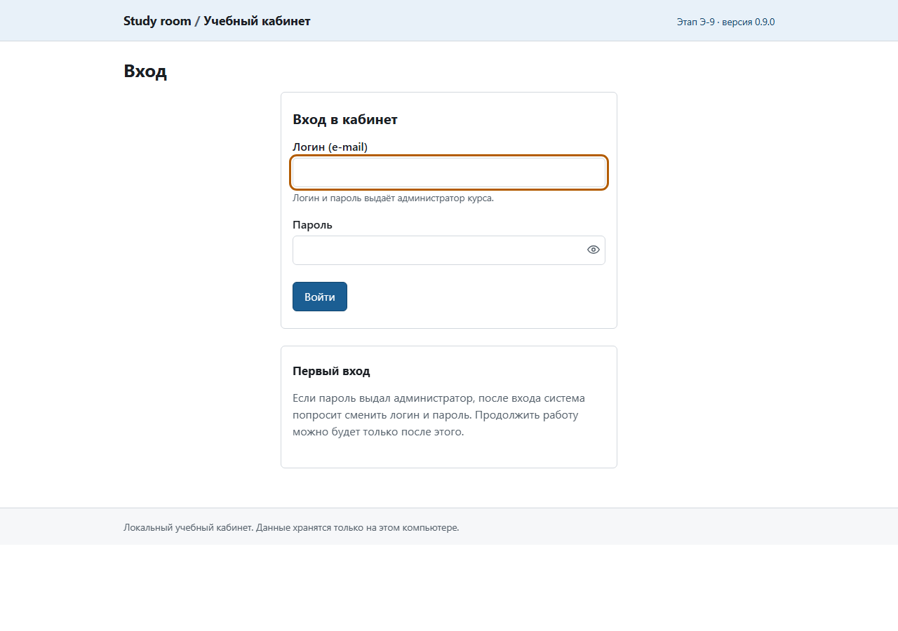
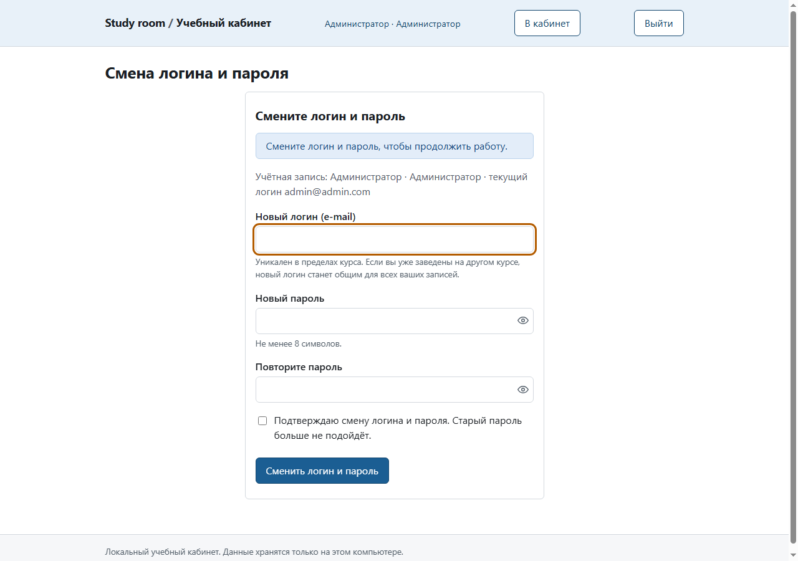
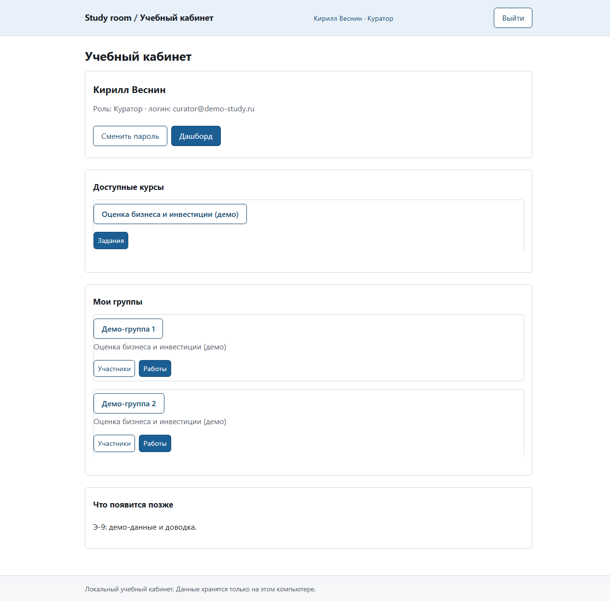
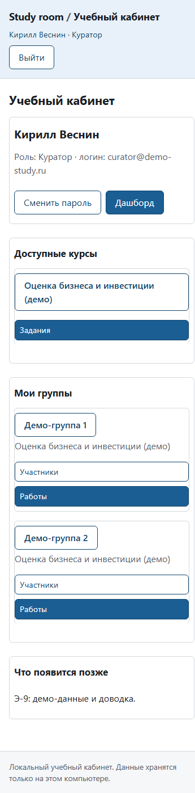
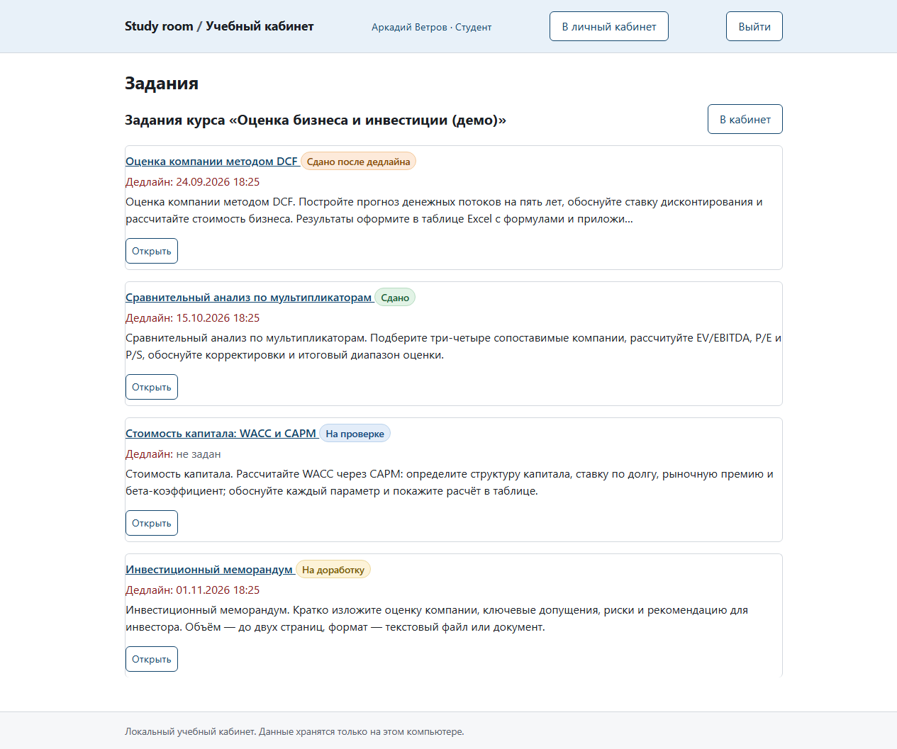
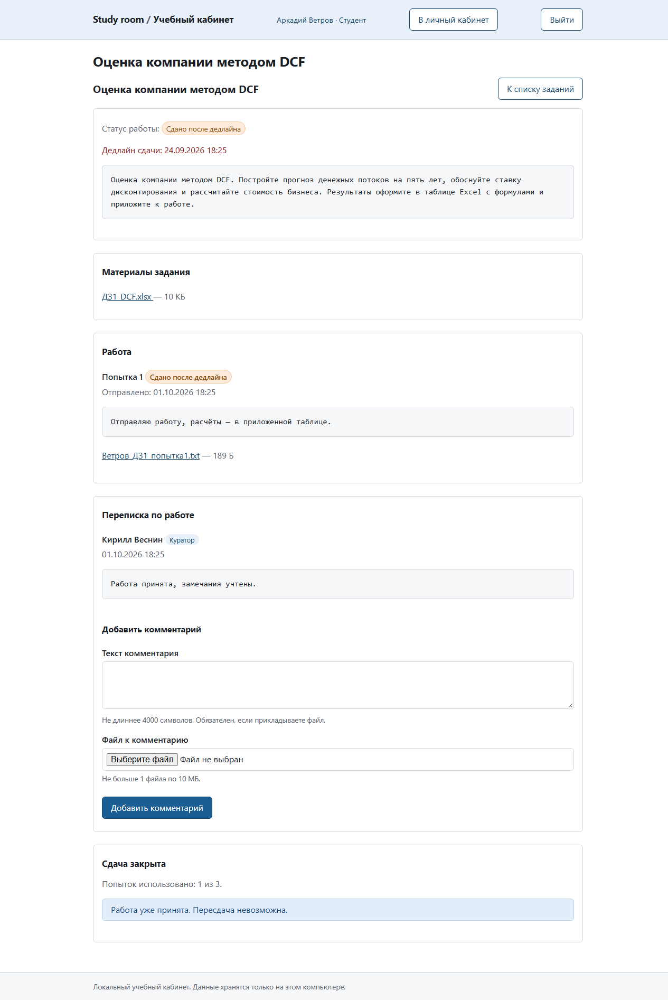
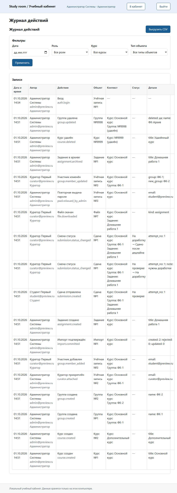

# Учебный кабинет (Study room)

Веб-сервис для организации учебного процесса: курсы, задания, сдача работ студентами, проверка кураторами, статусы и ведомость успеваемости — в одном локальном приложении без выхода в интернет.

**Последняя корректная версия:** `ver:2` (коммит `8d0b2c5`), версия приложения **0.11.0**, этапы Э-0…Э-11.
**Техническое задание:** 72 функциональных требования (FR), 38 бизнес-правил (BR), 47 критериев приёмки (AC), 14 нефункциональных требований (NFR) — см. [ТЗ_MVP.md](ТЗ_MVP.md).
**Автотесты:** 691 тест, команда — `pytest -q`.

## Содержание

1. [Что делает сервис и для кого](#что-делает-сервис-и-для-кого)
2. [Интерфейс](#интерфейс)
3. [Системные требования и поддерживаемые версии](#системные-требования-и-поддерживаемые-версии)
4. [Установка с чистого компьютера и запуск](#установка-с-чистого-компьютера-и-запуск)
5. [Конфигурация и .env.example](#конфигурация-и-envexample)
6. [Проверка работоспособности](#проверка-работоспособности)
7. [Публикация и обновление](#публикация-и-обновление)
8. [Резервное копирование и восстановление](#резервное-копирование-и-восстановление)
9. [Структура проекта](#структура-проекта)
10. [Ошибки, логи и восстановление](#ошибки-логи-и-восстановление)
11. [Известные ограничения](#известные-ограничения)
12. [Контакты поддержки](#контакты-поддержки)

---

## Что делает сервис и для кого

Сервис закрывает полный цикл учебного задания: администратор создаёт курс и группы, загружает реестр студентов из файла, куратор проверяет работы и оставляет обратную связь, студент сдаёт файлы и пересдаёт их, а руководитель видит картину по всем курсам в дашборде и выгружает ведомость в Excel.

**Для кого.** Для одного учебного подразделения (курса, кафедры, школы) в режиме локального пилота: приложение работает на одной машине в закрытой сети, данные хранятся в файле базы данных на этой же машине. В схеме нет полей для паспортных, платёжных и иных чувствительных данных — рассчитано на учебные и вымышленные данные.

**Три роли и их права:**

| Роль | Что видит и может |
|---|---|
| **Администратор** | Все курсы; создаёт/редактирует/удаляет курсы, задания, группы; импортирует реестры; управляет учётными записями и паролями (включая показ текущего пароля); видит дашборд по всем курсам, журнал действий, резервные копии, выгружает ведомость |
| **Куратор** | Только свои группы: дашборд прогресса, скачивание работ, статусы «сдано»/«на доработка», комментарии и файлы к ним, выгрузка ведомости по своим группам |
| **Студент** | Только свои курсы: задания, материалы, сдача файлов с комментарием (до 3 попыток), статусы и комментарии проверяющих |

**Ключевые возможности:**

- курсы, задания (текст или импорт описания из файла), прикреплённые материалы, необязательные дедлайны;
- группы студентов: ручной CRUD или импорт из Excel/CSV с предпросмотром и вердиктом по каждой строке;
- сдача работ: до 5 файлов, лимит 10 МБ на файл, проверка типа по расширению и содержимому;
- пересдача после «на доработку», лимит 3 попыток, блокировка до обратной связи;
- статусы: `не сдано`, `на проверке`, `на доработку`, `сдано`, `сдано после дедлайна` (последний система вычисляет сама по времени сдачи);
- дашборды с фильтрами: курс → группа → задание → студент;
- выгрузка ведомости успеваемости в Excel (три листа: сводка, разрезы, ведомость);
- журнал действий: кто, что и когда сделал (без IP-адресов);
- резервные копии: создание, скачивание, восстановление с предпросмотром;
- пароли: администратор видит текущий пароль и сбрасывает; учётные данные нельзя оставить по умолчанию.

---

## Интерфейс

Весь интерфейс на русском, адаптирован от 360 px без горизонтальной прокрутки. Скриншоты из рабочей версии:

**Вход в систему** и обязательная смена учётных данных при первом входе администратора:





**Дашборд куратора** — прогресс группы: ФИО, группа, дедлайн, статус; без e-mail и паролей:





**Студент: мои курсы** и карточка задания со сдачей:





**Журнал действий** администратора:



---

## Системные требования и поддерживаемые версии

**Системные требования:**

- **ОС:** Windows 10/11 (основной сценарий проверки), macOS, Linux;
- **Python:** 3.12 или новее — проверено на Python 3.14.7;
- **Место на диске:** ~500 МБ (код, виртуальное окружение, данные и загруженные файлы);
- **Браузеры:** актуальные версии Chrome, Microsoft Edge, Safari, Яндекс.Браузера;
- **Разрешение:** от 360 px по ширине;
- **Интернет:** нужен **только при установке** (загрузка зависимостей pip); во время работы приложение не обращается ни к одним внешним ресурсам;
- **СУБД:** SQLite — входит в состав Python, отдельно устанавливать не нужно.

**Поддерживаемые версии (проверено на этой комбинации):**

| Компонент | Версия |
|---|---|
| Python | 3.12+, проверено на 3.14.7 |
| Flask | 3.1.3 |
| openpyxl | 3.1.5 |
| cryptography | 50.0.0 |
| filetype | 1.2.0 |
| pytest | 9.1.1 |

Точные пины — в [requirements.txt](requirements.txt). Другие версии Python/библиотек не проверялись.

---

## Установка с чистого компьютера и запуск

Команды ниже копируются целиком. Показаны для **Windows (PowerShell)**; на macOS/Linux команды те же, кроме активации окружения — там `source .venv/bin/activate`.

### Шаг 1. Получить код

Распакуйте архив с проектом в любую папку (путь может содержать пробелы) либо клонируйте репозиторий:

```powershell
git clone АДРЕС_РЕПОЗИТОРИЯ
cd "Study room"
```

Убедитесь, что Python доступен в командной строке:

```powershell
python --version
```

Если команда не найдена — установите Python 3.12+ с официального сайта и отметьте опцию добавления в PATH.

### Шаг 2. Создать виртуальное окружение

```powershell
python -m venv .venv
```

Активировать окружение (команда выполняется в каждой новой консоли перед работой с проектом):

```powershell
.venv\Scripts\activate
```

> Если PowerShell блокирует активацию: `Set-ExecutionPolicy -Scope Process -ExecutionPolicy Bypass`

### Шаг 3. Установить зависимости

```powershell
pip install -r requirements.txt
```

На компьютере без интернета заранее подготовьте папку с пакетами и ставьте из неё:

```powershell
pip download -r requirements.txt -d wheels
pip install --no-index --find-links wheels -r requirements.txt
```

### Шаг 4. Первая инициализация

```powershell
python -m app.cli setup
```

Команда выполняет всё сразу: создаёт ключ шифрования (`var/secret.key`), базу данных (`data/study_room.db`) со схемой и наполняет её демо-данными (демо-курс, две группы, куратор, студенты, 40 работ) — их удобно использовать для проверки.

Чистая установка без демо-данных — по шагам:

```powershell
python -m app.cli init-key
python -m app.cli init-db
```

### Шаг 5. Запустить

```powershell
flask --app app run
```

Откройте в браузере **http://127.0.0.1:5000**. Остановка — `Ctrl+C` в консоли (работа останавливается сразу).

**Учётные записи демо-данных:**

| Роль | Логин (e-mail) | Пароль |
|---|---|---|
| Администратор | `admin@admin.com` | `1234` |
| Куратор | `curator@demo-study.ru` | `Demo1234` |
| Студент | `vetrov@demo-study.ru` | `Demo1234` |

Первый вход администратора требует смены логина и пароля — рабочие экраны недоступны, пока учётные данные не изменены.

---

## Конфигурация и .env.example

Приложение **не читает переменные окружения автоматически**: все настройки самого сервиса (хост, порт, лимиты файлов, пути к данным) лежат в файле [`app/config.py`](app/config.py) и меняются правкой этого файла с последующим перезапуском.

Имена переменных окружения, которые распознают инструменты запуска (Flask CLI и Python), перечислены в файле [`.env.example`](.env.example) — **только имена, без значений**:

| Имя переменной | Назначение |
|---|---|
| `FLASK_APP` | с какого модуля запускать Flask CLI |
| `FLASK_DEBUG` | режим отладки Flask CLI |
| `PYTHONIOENCODING` | кодировка вывода консоли (важно для Windows с кириллицей) |

Файл `.env.example` — справочный шаблон: приложение его не загружает. Задавайте переменные в оболочке перед запуском (`$env:ИМЯ=` в PowerShell, `export ИМЯ=` в bash) либо просто используйте команды из раздела установки — они работают и без переменных.

Файлы с секретами и данными (`var/secret.key`, каталоги `data/` и `var/`) входят в `.gitignore` и **не должны попадать в репозиторий**.

---

## Проверка работоспособности

### Автоматические тесты

В корне проекта, с активированным окружением:

```powershell
pytest -q
```

Ожидаемый итог: **691 passed**. Тесты покрывают бизнес-правила, ролевой доступ, импорт, сдачи, ведомость, резервные копии и нефункциональные требования — падение любого из них означает, что установка или обновление прошли некорректно.

### Главный пользовательский сценарий — полный цикл задания

Выполняется на демо-данных, ~10 минут:

1. Войдите как `admin@admin.com` / `1234` → система требует сменить логин и пароль → задайте новые, перелогиньтесь.
2. Нажмите «Создать курс», введите название, добавьте задание (название, описание, файл-материал, дедлайн), сохраните с предпросмотром.
3. Откройте «Редактировать курс / группы студентов» → «Добавить группу» → загрузите файл реестра (эталоны — в папке [`Inputs/`](Inputs/)) → проверьте предпросмотр с вердиктами строк → подтвердите импорт.
4. Прикрепите куратора к группе и выдайте ему пароль.
5. Войдите как `curator@demo-study.ru` / `Demo1234` → откройте дашборд → видите свою группу и прогресс (без e-mail и паролей студентов).
6. Войдите как `vetrov@demo-study.ru` / `Demo1234` → «Мои курсы» → откройте задание → скачайте материалы → сдайте файл с комментарием (попытка №1, статус «на проверке»).
7. Вернитесь в учётку куратора → откройте работу → скачайте файл → поставьте «на доработку» с комментарием и файлом.
8. Студент видит комментарий и сдаёт исправленную работу (попытка №2).
9. Куратор ставит «сдано» (если после дедлайна — система покажет «сдано после дедлайна»).
10. Войдите обратно как администратор → дашборд с фильтрами (курс → группа → задание → студент) → «Выгрузить ведомость» (XLSX) → журнал действий → «Резервные копии» → создайте и скачайте копию.

### Сценарии ролей (краткая проверка)

- **Администратор:** дашборд и фильтры; импорт с отбраковкой (строка с пустым паролем и дублем e-mail — с номером ошибки); показ/сброс пароля студента; каскадное удаление курса с вводом названия; архивирование задания со сдачами; выгрузка ведомости; восстановление из резервной копии (с предпросмотром до применения).
- **Куратор:** видит только свои группы; попытки из статуса «на проверке» недоступны до обратной связи; после 3 попыток сдача блокирована; терминальные статусы менять не может.
- **Студент:** чужие курсы и чужие работы недоступны (403); прогресс пересчитывается сразу после смены статуса.
- **Доступ:** выход из чужой роли — 403, без сессии — редирект на вход; повторный вход сбрасывает корзину фильтров.
- **Адаптив:** откройте те же экраны при ширине окна 360 px — горизонтальной прокрутки нет.

---

## Публикация и обновление

### Публикация (деплой)

Приложение — обычный локальный веб-сервер: по умолчанию слушает **127.0.0.1:5000**, то есть доступно только с той же машины. Это осознанное решение для локального пилота.

**Вариант А — работать в консоли** (команда из раздела запуска). Для запуска в фоне/автозагрузке на Windows создайте задачу планировщика:

```powershell
$action = New-ScheduledTaskAction -Execute "$PWD\.venv\Scripts\flask.exe" -Argument "--app app run" -WorkingDirectory "$PWD"
$trigger = New-ScheduledTaskTrigger -AtLogOn
Register-ScheduledTask -TaskName "StudyRoom" -Action $action -Trigger $trigger
```

**Вариант Б — доступ с других машин локальной сети.** В [`app/config.py`](app/config.py) измените адрес привязки (`SERVER_HOST`) на `0.0.0.0`, перезапустите приложение и разрешите порт 5000 в брандмауэре. Используйте **только в закрытой сети**: HTTPS не предусмотрен, приложение не предназначено для выхода в интернет.

После первого запуска в новой среде выполните шаги 2–4 установки (окружение → зависимости → `python -m app.cli setup`).

### Обновление

1. Сделайте резервную копию (раздел ниже).
2. Замените код на новую версию (для git-репозитория — в корне проекта):

```powershell
git pull
```

3. Обновите зависимости, если изменился `requirements.txt`:

```powershell
pip install -r requirements.txt
```

4. Проверьте и запустите:

```powershell
pytest -q
flask --app app run
```

Схема базы обновляется **автоматически при старте** приложения (миграции из `migrations/`), команду `python -m app.cli setup` при обновлении повторять не нужно — она только для первой установки. Если тесты упали — откатитесь на предыдущую версию кода и восстановите базу из копии.

---

## Резервное копирование и восстановление

Копия должна включать три вещи: базу с загруженными файлами (`data/`), ключ шифрования (`var/secret.key`) и — при необходимости — сам код.

**Способ 1. Через интерфейс (рекомендуется).** Администратор → «Резервные копии»:

- «Создать» — снимок в формате JSON (курсы, группы, работы, комментарии, журнал);
- «Скачать» — сохранить файл копии себе;
- «Загрузить» — перед применением показывается превью изменений, копия применяется только после подтверждения.

**Способ 2. Копирование файлов (для полного восстановления вместе с файлами работ).** Остановите приложение и скопируйте каталоги:

```powershell
Copy-Item -Recurse data, var "D:\Backup\StudyRoom-$(Get-Date -Format yyyy-MM-dd)"
```

**Восстановление (полное):** остановите приложение, замените каталоги `data/` и `var/` из копии, запустите приложение. Если обновлялся и код — верните и код той версии, с которой снята копия.

**Регламент:** минимум — перед каждым обновлением и в конце каждой учебной недели; храните копии вне рабочей папки.

---

## Структура проекта

```
Study room/
├── app/                      приложение Flask
│   ├── blueprints/           экраны по ролям: auth, admin_*, curator, student, files
│   ├── services/             бизнес-логика: импорт реестров, сдачи, статусы,
│   │                         дашборды, ведомость, резервные копии, журнал
│   ├── templates/            шаблоны страниц (Jinja2), errors/, partials/
│   ├── static/               CSS и JavaScript (без внешних библиотек)
│   ├── cli.py                команды: setup, init-key, init-db, seed-demo
│   ├── config.py             настройки: хост, порт, лимиты, пути
│   ├── db.py                 подключение и запросы к SQLite (SQL вручную, без ORM)
│   ├── passwords.py          хранение паролей (хеш + обратимое шифрование)
│   ├── security.py           сессии, CSRF, заголовки
│   └── action_log.py         журнал действий
├── migrations/               SQL-схема и индексы (001…004)
├── tests/                    автотесты pytest (691 тест)
├── docs/screenshots/         скриншоты интерфейса (для README и портфолио)
├── data/                     база и загрузки — НЕ попадает в git
├── var/                      ключ шифрования — НЕ попадает в git
├── Inputs/                   исходные материалы: бриф, эталонные файлы импорта,
│                             чек-лист приёмки
├── Шаблоны/                  шаблон аналитической записки
├── README.md                 этот файл — установка и сопровождение
├── ТЗ_MVP.md                 техническое задание (FR/BR/AC/NFR, схема, этапы)
├── DEVELOPMENT.md            история разработки по этапам (Э-0…Э-11)
├── AGENTS.md                 правила работы с репозиторием
├── .env.example              шаблон имён переменных окружения
└── requirements.txt          точные версии зависимостей
```

---

## Ошибки, логи и восстановление

### Где смотреть логи

Все сообщения, ошибки и трейсбеки выводятся **в консоль, где запущено приложение** (`flask --app app run`). Окно консоли — основной лог. Критические действия (входы, импорты, сдачи, смена статусов, удаления, копии) дополнительно пишутся в **журнал действий** внутри приложения: Администратор → «Журнал действий».

### Если что-то не работает

| Ситуация | Что делать |
|---|---|
| `python` не найден | Установите Python 3.12+ и добавьте в PATH либо используйте `py -3` вместо `python` |
| Ошибка при активации окружения (политика выполнения) | `Set-ExecutionPolicy -Scope Process -ExecutionPolicy Bypass` |
| «нет такого файла `var/secret.key`» или приложение не стартует | `python -m app.cli init-key`, затем `python -m app.cli init-db`; для новой установки — `python -m app.cli setup` |
| Пустое приложение, нет демо-данных | `python -m app.cli seed-demo` (демо) или `python -m app.cli init-db` (чистая база) |
| `Address already in use` / порт занят | `flask --app app run --port 5001` (порт меняется и в `app/config.py`) |
| В консоли ошибка кодировки (кириллица, Windows) | Задайте переменную `PYTHONIOENCODING` (см. `.env.example`) и перезапустите |
| Браузер показывает старую страницу | Обновите страницу с принудительной перезагрузкой (`Ctrl+F5`) |
| `pip install` падает без интернета | Используйте заранее подготовленные пакеты: `pip install --no-index --find-links wheels -r requirements.txt` |
| Студент забыл пароль | Администратор видит текущий пароль в учётной записи и может назначить новый |
| После обновления — ошибки или падают тесты | Верните предыдущую версию кода, остановите приложение, восстановите `data/` и `var/` из резервной копии, запустите снова |
| Нужно начать «с нуля» | Удалите (или переименуйте) каталоги `data/` и `var/`, выполните `python -m app.cli setup` |
| Сбой при импорте реестра | Ничего не записано: исправьте строки по отчёту (номера и причины) и загрузите файл повторно |

После любого восстановления проверьте:

```powershell
pytest -q
```

---

## Известные ограничения

- **Локальный пилот, одна машина.** SQLite и однопроцессный сервер рассчитаны на десятки пользователей в закрытой сети, не на высокую нагрузку и не на публичный интернет.
- **Нет HTTPS.** При доступе с других машин используйте только закрытую сеть.
- **Нет публичной регистрации.** Учётные записи заводит администратор.
- **Намеренно вне объёма** (по ТЗ, §4.2): поиск, сортировка, пагинация, предпросмотр файлов в браузере, уведомления, чат, балльная оценка, антиплагиат, PDF-выгрузка, мобильное приложение, CRM, внешние AI и сторонние API.
- **Лимиты:** файл — 10 МБ; до 5 файлов на задание, сдачу и комментарий; 3 попытки сдачи; типы файлов — `xlsx, xls, docx, pdf, csv, txt, md, png, jpg, zip` (проверка по расширению и содержимому).
- **Пароли читаемы администратором** — требование функциональной возможности (FR-09): это осознанный риск, зафиксированный в ТЗ (Р-01).
- **Пароли в реестрах импорта.** Шаблон формулы пароля в эталонных файлах узкий (`=LEFT(D2,4)&F2`); другая формула без кэшированного значения вернёт понятную ошибку по строке.
- **Данные — только учебные/вымышленные:** полей для паспортных и платёжных данных в схеме нет, IP-адреса в журнал не пишутся.
- **Демо-данные** создаются командой `setup`; рабочая установка «в пустую» — `init-key` + `init-db`.
- **Интерфейс и документация — только на русском языке** (NFR-13).

---

## Контакты поддержки

Вопросы по установке, обновлению и работе сервиса: **__<впишите контакт сопровождающего при передаче>__**.

Полный перечень приёмочных проверок — [Inputs/checklist.md](Inputs/checklist.md); структура требований и этапов — [ТЗ_MVP.md](ТЗ_MVP.md).
